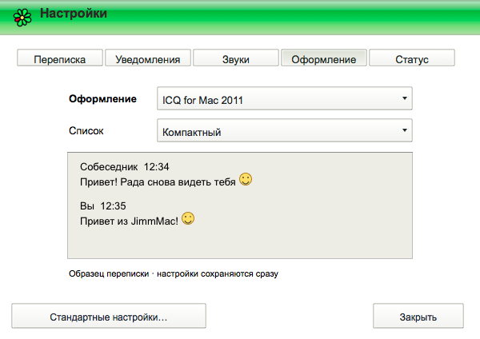
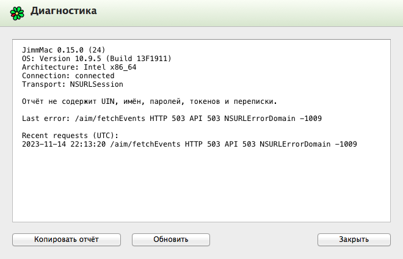

<div align="center">
  
  <h1>JimmMac</h1>
  <p><b>Знакомый цветок. Любимый Mac. Новый разговор.</b></p>
  <p>
    
    
    
  </p>
  <p>
    <a href="https://github.com/MiChiRose/JimmMac/releases/latest"><b>Скачать JimmMac</b></a>
    · <a href="https://github.com/MiChiRose/JimmMac/issues">Сообщить о проблеме</a>
    · <a href="docs/README.en.md">English version</a>
  </p>
</div>

## Переписка ICQ на привычном Mac

JimmMac — независимый клиент [Jimm.online](https://jimm.online), сервиса,
возрождающего общение в духе ICQ. Вход по UIN, контакты и повседневная переписка
доступны на Intel и Apple Silicon Mac. Интерфейс AppKit сохраняет знакомые темы,
цветок ICQ и звуки сообщений. Доступны русский, английский, украинский и белорусский.

<p align="center">
  
</p>
<p align="center"><em>Нативный AppKit на Mavericks. На снимке — вымышленная переписка.</em></p>

## Скачать и установить

| Загрузка | Что выбрать |
| --- | --- |
| [Универсальный DMG 0.17.0](https://github.com/MiChiRose/JimmMac/releases/download/v0.17.0/JimmMac-0.17.0-macos10.13plus-universal.dmg) | Intel с macOS 10.13 и новее, Apple Silicon с macOS 11 и новее. |
| [Универсальный ZIP 0.17.0](https://github.com/MiChiRose/JimmMac/releases/download/v0.17.0/JimmMac-0.17.0-macos10.13plus-universal.zip) | То же приложение в ZIP-архиве. |
| [DMG 0.17.0 для старых Intel Mac](https://github.com/MiChiRose/JimmMac/releases/download/v0.17.0/JimmMac-0.17.0-macos10.8-10.13-x86_64.dmg) | Для Intel с OS X 10.8–macOS 10.13. |
| [ZIP 0.17.0 для старых Intel Mac](https://github.com/MiChiRose/JimmMac/releases/download/v0.17.0/JimmMac-0.17.0-macos10.8-10.13-x86_64.zip) | Та же сборка в ZIP-архиве. |
| [Описание релиза и контрольные суммы SHA-256](https://github.com/MiChiRose/JimmMac/releases/tag/v0.17.0) | Изменения и контрольные суммы для 0.17.0. |

Откройте образ и перетащите JimmMac в «Программы». Перед заменой завершите
работающее приложение. Универсальная сборка подписана локально, без Developer ID
и нотариализации. Если macOS блокирует
первый запуск, используйте разрешение для этого приложения в разделе
«Конфиденциальность и безопасность». [Инструкция Apple](https://support.apple.com/en-us/102445).

Для входа нужны **UIN и пароль Jimm.online**. Если аккаунта ещё нет, начните
с [Jimm.online](https://jimm.online). Включите **«Запомнить меня»**, чтобы вход
восстанавливался после перезапуска приложения.

## Возможности

- Отдельные разделы **«Контакты»** и **«Переписки»**, поиск людей по UIN,
  добавление контактов и распределение по группам.
- Отправка и автоматическое получение текстовых сообщений, в том числе офлайн,
  счётчики непрочитанных, индикатор набора и восстановление соединения после обрыва сети.
- Локальная история, поиск старых сообщений, кликабельные ссылки и ответы с цитатой.
- Черновики, которые возвращаются после перезапуска, отдельно для каждого
  собеседника и аккаунта.
- Профили и аватары собеседников, редактирование своего профиля и фотографии,
  смена сетевого статуса с подтверждением сервера.
- Настройки шрифта сообщений, звуков, содержимого уведомлений и отправки по Enter.
- Нативные сочетания клавиш, включая команды с Command в русской раскладке.
  Полный список доступен в **«Справка → Сочетания клавиш…»**.

<details>
<summary><b>Ещё несколько экранов: контакты, профиль и вход</b></summary>

<p align="center">
  
  
  
</p>

</details>

## Новое в 0.17.0

- Две сборки в одном выпуске. Legacy для Intel с OS X 10.8–macOS 10.13 и универсальная для Intel и Apple Silicon.
- Закрепление переписок и переход к следующей непрочитанной через **⌘U**.
- Быстрый переход к переписке по имени или UIN через **⌘K**.
- Статус переподключения в окне чата и ручной повтор отправки с подтверждением.

## Новое в 0.16.0

- Добавлены темы QIP и Jimm. В исторических темах используются оригинальные значки и анимации старых смайликов.
- Интерфейс доступен на русском, английском, украинском и белорусском.
- Контакты можно блокировать и разблокировать. Группы сворачиваются, а переписки можно отфильтровать по непрочитанным.
- Офлайн-сообщения и история текущей сессии объединяются без дублей по ID сообщения.
- При ручной проверке обновлений сразу появляется окно с индикатором.

## Новое в 0.15.0

- **Оформление вспомогательных окон.** Настройки, поиск, профили, группы,
  диагностика и локальные данные согласованы со всеми тремя режимами.
  Сохраняются системные рамки, поля ввода, фокус и сочетания клавиш Mac.
- **Диагностика.** «Справка → Диагностика…» показывает состояние подключения,
  транспорт и коды последних запросов. «Копировать отчёт» исключает UIN, имена,
  пароли, токены, адреса запросов с параметрами и текст сообщений.
- **Автоматический статус.** «Настройки → Статус»: 5, 10, 15, 30 или 60 минут
  бездействия на Mac. Возврат при активности относится только к автоматическому
  «Отошёл»; ручной статус имеет приоритет. По умолчанию функция выключена.
- **Навигация по истории.** Поиск по всем перепискам, текущей или конкретному
  собеседнику, включительный период дат, «К дню» для первого сообщения дня.
  Правый щелчок по сообщению → «Добавить закладку»; «Файл → Закладки сообщений…»
  открывает сохранённое. Закладки входят в `.jimmbackup`.
- **Локальные данные.** Меню JimmMac → «Локальные данные…»: количество сообщений,
  размер истории и кеша, отдельная очистка аватаров и удаление истории за период.
  Создание резервной копии перед удалением включено по умолчанию; если копия
  не записалась, история не удаляется. Исходный JSON миграции сохраняется отдельно.
- **Предпросмотр настроек.** «Настройки → Оформление»: образец переписки с выбранным
  шрифтом и смайликами, обычный/компактный список и возврат стандартных настроек.
  История, контакты, черновики и сохранённый вход при сбросе не удаляются.

[Проверка 0.15 на Mavericks](docs/VERIFICATION-0.15.md): 1269 автоматических
проверок и 583 строки RU/EN.

<table><tr>
<td></td>
<td></td>
</tr></table>

## Новое в 0.14

Все возможности 0.14 входят в 0.16.0. Историческая версия
исходников доступна по тегу `v0.14.2`.

- **Три оформления.** «Вид → Оформление»: текущий JimmMac, «Ностальгия · ICQ для
  Mac 2011» и «Ностальгия · ICQ Pro 2003b». В исторических режимах контакты
  находятся в отдельном компактном окне. Двойной щелчок или Enter открывает
  разговор. Оформление переключается сразу, сохраняя черновик; системные окна
  и команды клавиатуры остаются нативными для Mac.
- **История без интернета.** На экране входа нажмите «История офлайн…» или
  выберите «Файл → Открыть историю офлайн…». Можно читать, искать, экспортировать
  историю и писать черновики; для отправки нажмите «Подключиться». Сохранённые
  имена контактов доступны, их сетевой статус в этом режиме считается офлайн.
- **Перенос на другой Mac.** «Файл → Создать резервную копию…» сохраняет один
  файл `.jimmbackup`: история, черновики, локальные контакты и настройки.
  «Восстановить резервную копию…» доступно и до входа. История объединяется без
  дубликатов, разные черновики сохраняются вместе. Серверный контакт-лист не
  изменяется; после восстановления открывается офлайн-режим. Копия содержит
  переписку, но не пароль и не токен Связки ключей; на другом Mac войдите заново.
- **Тихие переписки.** Правый щелчок по собеседнику → «Отключить уведомления».
  Сообщения и счётчики сохраняются; баннеры, звук и привлечение внимания Dock
  для этой переписки отключены. Повторное действие включает уведомления.
- **Русский и English.** «Вид → Язык интерфейса». Язык применяется после обычного
  перезапуска из Finder; переводятся меню, окна, сообщения приложения и подсказки.

### Оформление по образцам в 0.14.2

Восстановлены разные формы кнопок и вкладок, тонкие кромки, скругления и
направление блика. Градиенты шапки Mac 2011 и кнопок Pro сняты с выбранных
изображений в sRGB. Pro использует отдельные поля UIN и ника, плотный список
и компактную полосу отправки. Mac 2011 — облачко своего статуса, значки
навигации, фотографии справа, вкладки со статусами и блоки сообщений с временем
справа. Фильтр группы доступен в меню справа от значков навигации.

[Источники и параметры отрисовки](docs/HISTORICAL-REFERENCE.md).

<table><tr>
<td></td>
<td></td>
</tr></table>

Для версии 0.14.2 на **OS X 10.9.5** пройдено 835 автоматических проверок и проверка покрытия 514 строк RU/EN. Реальные запуски на 10.8 и 10.13
остаются открытой задачей: эти системы сейчас недоступны. Одна сборка сохраняет
минимальную систему 10.8. [Подробности оформления](docs/APPEARANCE.md).

## Новые возможности 0.13.0

Изменения 0.13.0 входят в 0.16.0.

- **Непрочитанные после перезапуска.** Счётчики сохраняются вместе с сообщениями.
  При открытии разговора показывается первое непрочитанное; «К последним ↓»
  возвращает к концу и отмечает переписку прочитанной, когда она видна.
- **Большая история.** Сообщения сохраняются в SQLite, а окно показывает не более
  200 сообщений за раз. Кнопки «Ранее» и «Позже» открывают соседние страницы;
  поиск работает по всей истории и переводит к сообщению за пределами текущей
  страницы. Старая история переносится автоматически, исходный JSON остаётся
  резервной копией.
- **Состояния отправки.** В истории видны «Отправляется», «Принято сервером»,
  «Не отправлено» или «Подтверждение не получено». Последнее означает, что
  сообщение могло дойти. Правый щелчок → «Повторить отправку…» позволяет
  повторить вручную после подтверждения, сохраняя текущий черновик.
  «Принято сервером» не означает прочтение собеседником.
- **Проверка обновлений.** «JimmMac → Проверить обновления…» обращается к публичному
  API GitHub. Автоматическая проверка включена по умолчанию: при запуске и затем
  раз в 6 часов. Для новой версии окно появится само, когда открыто главное окно,
  по одному разу на версию. Ввод пароля и другие диалоги не прерываются. Проверку
  можно отключить в меню JimmMac; установка вручную, данные аккаунта не отправляются.
- **Избранное, фильтры и смайлики.** Правый щелчок по контакту → «Добавить в избранное»;
  такие контакты отмечены звездой и идут первыми. Флажки «Только в сети» и
  «Избранные» фильтруют текущий список. Настройки сохраняются отдельно для каждого
  аккаунта. Классические `:)`, `:(`, `;)` можно отключить в «Настройки → Переписка»
  или меню «Вид». При отправке, копировании и экспорте сохраняется исходный текст.
- **Экспорт переписки.** Выберите собеседника и откройте «Файл → Экспорт переписки
  в TXT…» или «…в HTML…». Сохраняется вся переписка, а не только видимая страница,
  с авторами, датами и состояниями неподтверждённых сообщений. HTML открывается
  без интернета и не выполняет разметку из текста сообщений.

<p align="center">
  
</p>

## Новое в 0.12.0

Улучшены навигация с клавиатуры, поведение Escape и Enter, отмена и повтор правок,
сочетания для работы с буфером обмена. История отмены разделена между переписками.
Новые сообщения сохраняют выделенный текст истории, чтобы его можно было
скопировать. Данные аккаунта и состояние соединения теперь находятся в разных
частях окна.

Классическое зелёно-серебристое оформление дополнено окнами «О программе»
и справки по клавиатуре. Для установки подготовлен оформленный DMG с перетаскиванием
в «Программы». Сетевой слой автоматически выбирает совместимый путь для OS X 10.8,
сохраняя одно приложение для всего целевого диапазона систем.

[Описание релиза 0.12.0](https://github.com/MiChiRose/JimmMac/releases/tag/v0.12.0).

## Совместимость и тестирование

| Сборка | Что проверено |
| --- | --- |
| 0.17.0 для Apple Silicon | Запуск и целевые проверки интерфейса на **macOS 27.2**. Минимум macOS 11. |
| 0.17.0 для Intel | Запуск Intel-кода через Rosetta на macOS 27.2. Минимум macOS 10.13. |
| 0.17.0 для старых Intel Mac | DMG, тесты приложения и проверка обновлений на **OS X 10.9.5**. Минимум OS X 10.8. |

Проверки на реальных Intel Mac с 10.13 и новее ещё нужны. Список проверок
и ограничения приведены в [VALIDATION.md](VALIDATION.md).

Если тестируете приложение, [создайте issue](https://github.com/MiChiRose/JimmMac/issues):
укажите версию системы и JimmMac, свои действия и полученный результат. Для начала
полезно проверить установку, вход, автоматическое получение сообщений и повторный
запуск с сохранённым входом. Убирайте личные данные из снимков экрана и не публикуйте
пароли или токены сессии.

## Ваши данные

JimmMac не сохраняет пароль. При включённом сохранении входа токен с ограниченным
сроком действия хранится в системной Связке ключей. **Cmd+Q** сохраняет этот вход,
а **«Выйти из аккаунта»** удаляет его.

История сообщений и черновики хранятся локально в
`~/Library/Application Support/JimmMac/`, отдельно для каждого аккаунта.
История в SQLite и черновики в JSON **не зашифрованы**. Поиск работает по локальной истории.
Содержимое уведомлений можно изменить в настройках.

[Подробнее о данных и сетевом поведении](docs/GUIDE.ru.md#данные-и-сетевое-поведение).

## Сборка и устройство проекта

На современном Mac соберите универсальное приложение и запустите тесты
с установленными Xcode Command Line Tools.

```sh
bash scripts/build.sh modern
JIMMMAC_NATIVE_TESTS=1 bash scripts/test.sh
```

Откройте `build/JimmMac.app` из Finder. Для сборки с минимумом OS X 10.8
используйте `bash scripts/build.sh legacy` под Xcode 5.1.1 или 6.2.

[Подробная инструкция: сборка, упаковка и архитектура](docs/GUIDE.ru.md)
· [Результаты проверок](VALIDATION.md)
· [Документация API Jimm.online](https://jimm.online/developers)

## Больше возможностей для старых Mac

Если вы также пользуетесь Telegram, посмотрите
[Telegraphica для Mac](https://github.com/MiChiRose/telegraphica) — наш отдельный
клиент для старых Intel Mac. Ссылка на него есть и внутри JimmMac:
**«Справка → Telegraphica для Mac…»** и **«О JimmMac»**.

JimmMac разрабатывает **Юра Менщиков**. Спасибо автору Jimm.online за сервис
и API, благодаря которым это общение стало возможным.

<sub>Бренд ICQ, графика и звуки принадлежат соответствующим правообладателям.
См. <a href="Resources/ASSET-SOURCES.md">источники ресурсов и указание авторства</a>.</sub>
