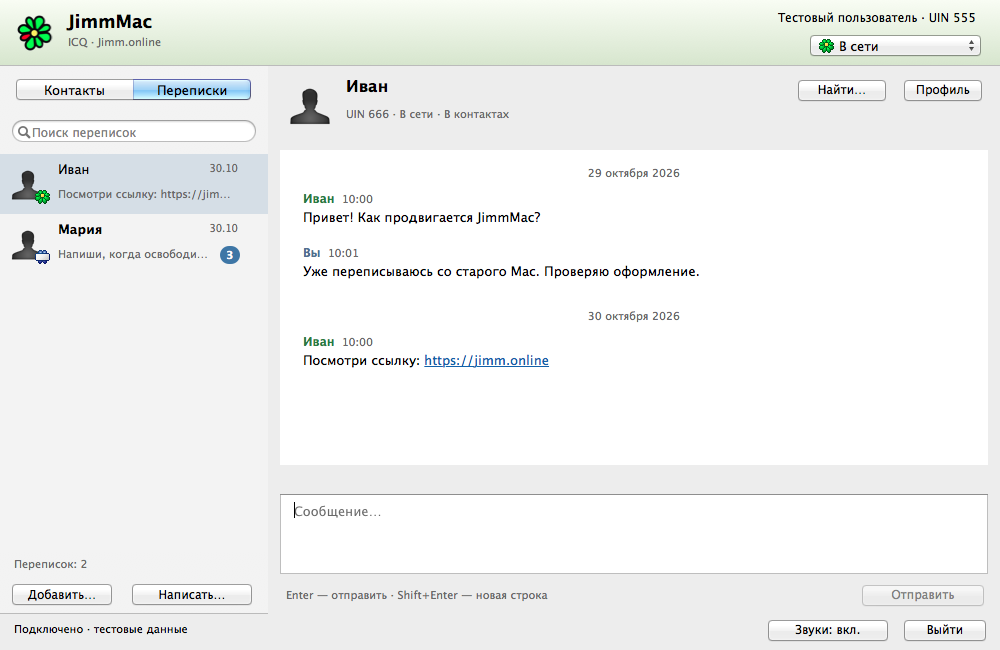
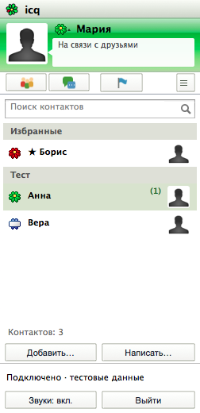
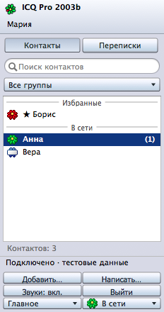

# JimmMac — ICQ для OS X 10.8–macOS 10.13

Нативное приложение Objective-C / AppKit, Intel x86_64, минимальная система OS X 10.8.
Независимый клиент сети Jimm.online. Версия исходников 0.14.2.



## Новое в 0.14

Текущий опубликованный релиз — **0.14.2**. Все возможности ниже доступны
в готовом приложении; исходники этой версии отмечены тегом `v0.14.2`.

- **Три оформления.** «Вид → Оформление»: текущий JimmMac, «Ностальгия · ICQ для
  Mac 2011» и «Ностальгия · ICQ Pro 2003b». В исторических режимах контакты
  находятся в отдельном компактном окне. Двойной щелчок или Enter открывает
  разговор. Оформление переключается сразу, сохраняя черновик; системные окна
  и команды клавиатуры остаются нативными для Mac.
- **История без интернета.** На экране входа нажмите «История офлайн…» или
  выберите «Файл → Открыть историю офлайн…». Можно читать, искать, экспортировать
  историю и писать черновики; для отправки нажмите «Подключиться». Сохранённые
  имена контактов доступны, их сетевой статус в этом режиме считается офлайн.
- **Перенос на другой Mac.** «Файл → Создать резервную копию…» сохраняет один
  файл `.jimmbackup`: история, черновики, локальные контакты и настройки.
  «Восстановить резервную копию…» доступно и до входа. История объединяется без
  дубликатов, разные черновики сохраняются вместе. Серверный контакт-лист не
  изменяется; после восстановления открывается офлайн-режим. Копия содержит
  переписку, но не пароль и не токен Связки ключей; на другом Mac войдите заново.
- **Тихие переписки.** Правый щелчок по собеседнику → «Отключить уведомления».
  Сообщения и счётчики сохраняются; баннеры, звук и привлечение внимания Dock
  для этой переписки отключены. Повторное действие включает уведомления.
- **Русский и English.** «Вид → Язык интерфейса». Язык применяется после обычного
  перезапуска из Finder; переводятся меню, окна, сообщения приложения и подсказки.

### Оформление по образцам в 0.14.2

Восстановлены разные формы кнопок и вкладок, тонкие кромки, скругления и
направление блика. Градиенты шапки Mac 2011 и кнопок Pro сняты с выбранных
изображений в sRGB. Pro использует отдельные поля UIN и ника, плотный список
и компактную полосу отправки. Mac 2011 — облачко своего статуса, значки
навигации, фотографии справа, вкладки со статусами и блоки сообщений с временем
справа. Фильтр группы доступен в меню справа от значков навигации.

[Источники и параметры отрисовки](HISTORICAL-REFERENCE.md).

<table><tr>
<td></td>
<td></td>
</tr></table>

Проверка выполняется на **OS X 10.9.5**. Пройдено 835 автоматических проверок и проверка покрытия 514 строк RU/EN. Реальные запуски на 10.8 и 10.13
остаются открытой задачей: эти системы сейчас недоступны. Одна сборка сохраняет
минимальную систему 10.8. [Подробности оформления](APPEARANCE.md).

## Новые возможности 0.13.0

Изменения 0.13.0 входят в текущую версию исходников.

- **Непрочитанные после перезапуска.** Счётчики сохраняются вместе с сообщениями.
  При открытии разговора показывается первое непрочитанное; «К последним ↓»
  возвращает к концу и отмечает переписку прочитанной, когда она видна.
- **Большая история.** Сообщения сохраняются в SQLite, а окно показывает не более
  200 сообщений за раз. Кнопки «Ранее» и «Позже» открывают соседние страницы;
  поиск работает по всей истории и переводит к сообщению за пределами текущей
  страницы. Старая история переносится автоматически, исходный JSON остаётся
  резервной копией.
- **Состояния отправки.** В истории видны «Отправляется», «Принято сервером»,
  «Не отправлено» или «Подтверждение не получено». Последнее означает, что
  сообщение могло дойти. Правый щелчок → «Повторить отправку…» позволяет
  повторить вручную после подтверждения, сохраняя текущий черновик.
  «Принято сервером» не означает прочтение собеседником.
- **Проверка обновлений.** «JimmMac → Проверить обновления…» обращается к публичному
  API GitHub. Автоматическая проверка включена по умолчанию: при запуске и затем
  раз в 6 часов. Для новой версии окно появится само, когда открыто главное окно,
  по одному разу на версию. Ввод пароля и другие диалоги не прерываются. Проверку
  можно отключить в меню JimmMac; установка вручную, данные аккаунта не отправляются.
- **Избранное, фильтры и смайлики.** Правый щелчок по контакту → «Добавить в избранное»;
  такие контакты отмечены звездой и идут первыми. Флажки «Только в сети» и
  «Избранные» фильтруют текущий список. Настройки сохраняются отдельно для каждого
  аккаунта. Классические `:)`, `:(`, `;)` можно отключить в «Настройки → Переписка»
  или меню «Вид». При отправке, копировании и экспорте сохраняется исходный текст.
- **Экспорт переписки.** Выберите собеседника и откройте «Файл → Экспорт переписки
  в TXT…» или «…в HTML…». Сохраняется вся переписка, а не только видимая страница,
  с авторами, датами и состояниями неподтверждённых сообщений. HTML открывается
  без интернета и не выполняет разметку из текста сообщений.

## Установка из DMG

Откройте `JimmMac-0.14.2-macos10.8-10.13-x86_64.dmg`, перетащите цветок JimmMac на
значок Applications («Программы») и запустите приложение из «Программ».
Образ HFS+ / UDZO рассчитан на диапазон 10.8–10.13. В окне есть фон, стрелка, инструкция
и значок папки Applications. Установка не меняет историю, черновики и сохранённый вход.

## Совместимость 10.8–10.13

Один Intel x86_64 bundle сохраняет прежний bundle ID и пути данных аккаунта.
На 10.8 автоматически применяется NSURLConnection; на 10.9–10.13 — NSURLSession.
Оба пути сохраняют отмену, дедлайны, отключённые cookies/credential storage/cache,
лимиты ответов и запрет перенаправлений API. TLS-проверка системы включена.
Аватары могут перенаправляться только внутри того же HTTPS-origin.
Уведомления на 10.8 объединяются по данным account/peer без свойства identifier.

Фактически доступна для запуска только OS X 10.9.5. На ней проверены оба сетевых
пути, ветвь уведомлений без identifier, клавиатура и UI. Проверена сборка старым
Xcode 5.1.1, Mach-O minimum 10.8 и weak linking классов 10.9.
Запуск на настоящих 10.8 и 10.13 пока не выполнялся; различия системного TLS,
корневых сертификатов и рендеринга на этих системах требуют отдельной проверки.

## Клавиатура и оформление 0.12

Имя и UIN показаны только справа вверху; внизу — состояние соединения.
Серебристые панели AppKit, мягкий зелёный заголовок ICQ, нативные кнопки,
системный шрифт Mavericks и текстовая история без пузырей.
«Справка → Сочетания клавиш…» содержит все действия и пояснения.

| Клавиши | Действие |
| --- | --- |
| Cmd+C / X / V / A | Копировать / вырезать / вставить / выделить всё в активном поле |
| Cmd+Z / Shift+Cmd+Z | Отменить / повторить правку |
| Option+Shift+Cmd+V | Вставить без оформления |
| Enter / Cmd+Enter | Отправить сообщение из поля ввода, по настройке |
| Shift+Enter / Option+Enter | Новая строка |
| Tab / Shift+Tab | Следующий / предыдущий элемент |
| Option+Tab | Табуляция внутри сообщения |
| Стрелки вверх / вниз | Выбрать контакт с сохранением фокуса в списке |
| Enter в списке | Перейти в поле сообщения без отправки |
| Escape | Закрыть вспомогательное окно; в главном — вернуть фокус в список |
| Cmd+N / Shift+Cmd+N | Написать по UIN / добавить контакт |
| Cmd+1 / Cmd+2 | Контакты / переписки |
| Cmd+L | Поиск в текущем списке |
| Cmd+F / Cmd+I / Cmd+, | История / мой профиль / настройки |
| Cmd+S в профиле | Сохранить изменения профиля |
| Cmd+W / M / H / Q | Закрыть окно / свернуть / скрыть / завершить |
| Cmd+0 | Открыть главное окно |
| Shift+Cmd+L | Выйти из аккаунта |

В поиске списка первый Escape очищает фильтр, следующий возвращает фокус
в список. Черновик не стирается. Enter в поле UIN переводит в поле пароля.
Системное защищённое поле поддерживает вставку; копирование пароля ограничено AppKit.
История отмены изолирована от других переписок и очищается после подтверждения
отправки. Новые сообщения сохраняют выделенный для копирования текст.
Ввод через IME получает Enter/Escape прежде действия приложения.

В «Справке» и «О JimmMac» есть ссылка на [Telegraphica](https://github.com/MiChiRose/telegraphica)
— наш отдельный клиент Telegram для старых Intel Mac.

## Что есть

- Вход по UIN и паролю Jimm.online. «Запомнить меня» сохраняет долгосрочный токен
  в системной Связке ключей и восстанавливает вход при следующем запуске.
  Пароль не сохраняется. Cmd+Q оставляет сохранённый вход; «Выйти из аккаунта»
  отключает автовход и удаляет токен JimmMac этого аккаунта.
  На время подключения есть кнопка «Отмена»: она возвращает ручной вход.
  Истёкший или отклонённый токен требует пароля; сетевой сбой не стирает его.
- Серверный контакт-лист, поиск, обновления присутствия, счётчики непрочитанных.
- Раздельные разделы «Контакты» и «Переписки». Контакты приходят с сервера,
  переписки включают только открытые разговоры и историю сообщений.
- Добавление контакта по UIN через «Добавить…» или «Добавить в контакты» в разговоре.
  Контакт сохраняется в Jimm.online; дубликаты обрабатываются без ошибки.
- Выбор группы при добавлении контакта, фильтр групп в разделе «Контакты».
- Меню «Контакты» и правый щелчок по строке: личное имя контакта, перенос между
  группами и удаление из всех групп. Перед удалением показывается подтверждение;
  переписка, черновик и локальная история сохраняются.
- Окно «Управление группами…»: создание, переименование и удаление пустых групп.
  Счётчик показывает число контактов; непустую группу сначала нужно освободить.
  При переносе из одной группы другие членства сохраняются.
- Разговор с контактом или произвольным UIN через «Написать…».
- Превью последних сообщений, сортировка переписок по времени и отдельный поиск.
  В строке переписки видно время последнего сообщения, «Вчера» или короткую дату;
  полная дата доступна по наведению. Черновик выделяется подписью и цветом,
  непрочитанные — жирным именем и отдельным счётчиком. После 99 отображается «99+»;
  полное число остаётся в подсказке и системном Accessibility API.
- Имена и статусы из API, карточка «Профиль» с информацией о собеседнике.
- Аватары из Jimm.online с локальным кэшем; при отсутствии фотографии — системный значок.
- «JimmMac → Мой профиль…» / Cmd+I: имя, фамилия, текст «О себе» и подпись статуса,
  выбор своего аватара с предпросмотром. JPEG, PNG и GIF до 20 МБ преобразуются
  в квадрат по центру до 256 × 256, JPEG до 64 КБ; поворот EXIF учитывается.
  Выбор фотографии можно отменить до сохранения. Текст «О себе» — до 4096 байт UTF-8,
  подпись — до 256 символов в одну строку; счётчики показывают текущий объём.
  Имя и фамилия — до 128 символов каждое. Пустой текст очищает соответствующее поле.
  После сохранения поля перечитываются с сервера. При частичном сбое повторяются
  только несохранённые изменения. Черновик сохраняется в окне при обрыве сети;
  закрытие с изменениями предлагает сохранить их или отказаться.
- Свой статус: «В сети», «Отошёл», «Не беспокоить», «Занят», «Невидимый».
  После переключения клиент перечитывает статус с сервера и показывает подтверждение,
  расхождение или недоступность проверки отдельно от результата изменения.
- Индикатор набора текста и отправка typing-событий с ограничением частоты.
- Кнопка повторного подключения, восстановление выбранного статуса в новой сессии
  и попытка подключения после пробуждения MacBook.
- Отправка текста, получение обычных и офлайн-сообщений, синхронизация sentIM.
- Long polling с повторным подключением и обработкой истёкшей сессии.
- Постоянная локальная история с разделением по аккаунтам и дедупликацией msgId.
  Сообщения сгруппированы по дням: дата показывается один раз по центру,
  рядом с именем остаётся только время. Полная дата и время есть в подсказке
  к заголовку. Отступы между заголовком и текстом и межстрочный интервал
  отделяют сообщения; разделители дат масштабируются с настройкой шрифта.
- Кликабельные HTTP/HTTPS-адреса и email в сообщениях. Подсказка показывает адрес;
  щелчок открывает системный браузер или почтовое приложение.
- «Найти…» / Cmd+F: поиск по всей локальной истории текущего аккаунта или выбранной
  переписке. Результаты идут от новых к старым; двойной щелчок или «Открыть»
  переводит к сообщению с выделением и подсветкой совпадения.
  Поиск не учитывает регистр; показывает до 200 сообщений и работает офлайн.
- «JimmMac → Настройки…» / Cmd+,: семейство шрифта и размер 9–28 пунктов,
  образец, немедленное применение к сообщениям и полю ввода, возврат к стандарту.
  Настройка сохраняется для приложения между запусками.
- Правый щелчок по сообщению: «Копировать сообщение целиком» без служебного заголовка
  или «Ответить цитатой». Цитата содержит автора, время и строки с `>`; добавляется
  перед набранным ответом и отправляется только по команде пользователя.
- В «Настройки → Переписка» можно выбрать отправку по Enter или Cmd+Enter.
  В режиме Cmd+Enter обычный Enter добавляет строку; Shift+Enter всегда добавляет
  строку. Cmd+Enter работает в поле сообщения, а не в окне поиска или настроек.
- Во время отправки можно продолжать писать. Успешное подтверждение убирает только
  отправленный текст, сохраняя набранное продолжение или новый черновик.
  Неудачная отправка сохраняет оба текста; автоматического повтора нет.
  Если выйти до подтверждения, исходный текст вернётся в черновик: перед повторной
  отправкой нужно проверить переписку, поскольку сервер мог уже принять сообщение.
- Для сообщения действует лимит клиента 4000 байт UTF-8: при превышении видно
  текущий объём и причину недоступности отправки. Длинный текст остаётся в черновике.
- В выбранном разговоре черновик доступен при обрыве сети; соединение требуется
  только для отправки. Черновики автоматически сохраняются на этом Mac отдельно
  для каждого UIN аккаунта и собеседника, возвращаются после повторного входа
  и перезапуска приложения. Успешная отправка и очистка поля удаляют свой черновик.
  При ошибке сохранения появляется подпись; выход позволяет вернуться к тексту.
- Пустая история предлагает начать разговор по UIN. При выбранном собеседнике
  без сообщений объясняет, что можно написать первым; поле ввода показывает
  «Сообщение…» как визуальную подсказку, не включая её в черновик или отправку.
- Список использует ровный серый фон и нативные элементы Mavericks. Активная
  выбранная строка синяя с белым текстом, неактивная — светлая с тёмным текстом.
  Отступы строк и нижней панели согласованы; обратная связь контакт-листа занимает
  дополнительное место только при наличии текста.
- Размеры вкладок и отступы учитывают системную отрисовку Mavericks. Длинные имена
  сокращаются многоточием; полные имена, UIN, статусы и превью доступны в подсказках.
- Новые сообщения появляются автоматически. При чтении последнего сообщения
  переписка прокручивается вниз; при чтении истории сохраняется позиция прокрутки.
- Кнопка «Новые: N ↓» переводит от старой истории к новым сообщениям.
  Прочтение учитывается, когда переписка видна и открыта на последних сообщениях.
  «Правка → Пометить всё прочитанным» очищает локальные счётчики и уведомления.
- Закрытие окна сохраняет подключение. Непрочитанные сообщения учитываются в Dock.
  Открыть окно снова можно из Dock или через «Окно → Открыть JimmMac» (Cmd+0).
- Системные уведомления Mavericks для сообщений вне просматриваемой переписки.
  Щелчок открывает нужный разговор; если требуется вход или восстановление связи,
  переход выполняется после подключения к соответствующему аккаунту.
- Настройки разделены на «Переписка», «Уведомления» и «Звуки».
  По умолчанию в баннере видно только имя отправителя. Можно показать начало
  сообщения или скрыть и имя, и текст. Есть отдельное управление вниманием Dock
  и кнопка «Проверить уведомление» без отправки сообщений собеседникам.
- Серии сообщений объединяются, запись в Центре уведомлений заменяется для того же
  собеседника. Прочтение убирает соответствующую запись; выход из аккаунта очищает
  показанные и ожидающие уведомления. У системного баннера нет дополнительного звука.
- Оригинальные звуки Jimm.online: сообщение, вход и выход контакта, набор текста.
  Кнопка «Звуки» отключает все звуки; отдельные события и прослушивание доступны
  в меню и настройках. Набор текста по умолчанию беззвучен. Звук для открытой
  переписки можно отключить отдельно.
  Дубликаты сообщений не повторяют звук, серия событий не играет одновременно,
  начальная загрузка контактов не вызывает серию звуков присутствия.

Регистрации, вложений и звонков пока нет.
Пункт «Написать…» открывает разговор, не добавляя контакт на сервер.
Оформление в духе Mavericks: системные элементы AppKit, серебристая панель,
цветок ICQ в Dock и при входе, компактные строки со статусами. Источник графики
и атрибуция находятся в Resources/ASSET-SOURCES.md.

## Сборка на старом Mac

Нужны Xcode с Command Line Tools и старым SDK. Проверены Xcode 5.1.1 (SDK 10.9)
и Xcode 6.2 (SDK 10.10); приложение собирается с target 10.8.
Современный Xcode 27 не содержит libarclite для такого deployment target;
основная сборочная среда этого проекта — настоящий Mac с 10.9.

```sh
cd ~/Desktop/JimmMac-Mavericks
bash scripts/test.sh
bash scripts/build.sh
./build/JimmMac.app/Contents/MacOS/JimmMac --probe-network
open build/JimmMac.app
```

Параметр --probe-network делает анонимные запросы к 19 маршрутам: getInfo,
fetchEvents, endSession, addBuddy, presence/get, getProfile, setState, setTyping,
setBuddyAttribute, removeBuddy, moveBuddy, addGroup, renameGroup, removeGroup,
setProfile, setStatus, memberDir/get, memberDir/update и expressions/upload
и проверяет их HTTP-методы, HTTPS и JSON. Ожидается ошибка авторизации 401 для
заведомо недействительной сессии; 404 считается ошибкой проверки. Вход и отправка
сообщений не выполняются. Проверка сертификатов остаётся включённой.

При установке по SSH после копирования сборки запустите JimmMac вручную из
Finder на самом Mac: `~/Desktop/JimmMac-Mavericks/build/JimmMac.app`.
Не запускайте установленный клиент через `ssh … open …`: на этом Mavericks
такой процесс не получает графического доступа Security, и сохранение входа
может завершиться ошибкой Связки ключей. Если клиент уже открыт удалённо,
сначала завершите его через Cmd+Q. После обычного запуска из Finder сохранение
токена и автоматический вход подтверждены пользователем. Менять настройки
блокировки Связки ключей для этого не потребовалось.

`bash scripts/ui-smoke.sh` проверяет создание и уменьшение окон и сохраняет в build/
снимки нативного интерфейса с фиктивными данными; в реальный аккаунт он не входит.

## Первая ручная проверка

1. Ввести UIN и пароль непосредственно в приложении, нажать «Войти».
2. Проверить раздел «Контакты» и поиск. Нажать «Добавить…» и указать нужный UIN.
   Для теста подходит бот 11114. Проверить, что контакт появился на сервере.
3. Переключиться в «Переписки». Само добавление контакта не должно создавать разговор.
   Открыть контакт или нажать «Написать…» и проверить отдельный список разговоров.
4. Открыть собеседника, отправить сообщение и получить ответ с другого клиента.
5. Проверить русский текст, знаки `+`, `&`, перенос строки и длинное сообщение.
6. Завершить приложение, открыть и войти повторно: история и открытые разговоры сохраняются.
7. Отключить Wi-Fi на короткое время и вернуть сеть: клиент должен восстановиться.
8. Проверить неверный пароль: приложение возвращает ошибку, поле пароля очищено.
9. Нажать «Профиль»: проверить имя, сведения и аватар, если он есть у собеседника.
10. Выбрать «Отошёл» справа вверху и дождаться «Статус подтверждён сервером».
    Если сервер вернул другой статус или повторный запрос не удался, клиент сообщит об этом.
11. Проверить индикатор набора текста с согласованным собеседником во втором клиенте.
12. Проверить вкладки при уменьшении окна; навести мышь на кнопку и длинное имя.
13. Отправить `!help` боту 11114: ответ должен появиться сам, со звуком сообщения.
14. В меню «Звуки» прослушать четыре сигнала и проверить общую кнопку отключения.
15. Закрыть окно (Cmd+W): приложение остаётся подключённым. Вновь открыть через
    Dock или Cmd+0. Завершить приложение и отключиться — Cmd+Q.
16. Открыть сообщение со ссылкой: проверить подсказку и открытие браузера по щелчку.
17. Нажать «Найти…» или Cmd+F, найти слово из старого сообщения. Проверить оба
    варианта области поиска и переход к найденному сообщению двойным щелчком.
18. В настройках (Cmd+,) выбрать семейство и размер шрифта. Проверить сообщения,
    поле ввода, сохранение настройки после перезапуска и «По умолчанию».
19. В меню «Контакты → Управление группами…» создать группу «Проверка».
    Выбрать её в фильтре контактов. Проверить пустой список и возможность добавления.
20. Добавить тестового бота 11114 в выбранную группу или перенести уже существующий
    контакт через правый щелчок → «Переместить в группу…». Через то же меню изменить имя.
    Выйти и войти снова: имя и группа должны прийти из Jimm.online.
21. Проверить удаление на тестовом контакте: после подтверждения он исчезает из
    «Контактов», но его переписка и история остаются. Удаление группы доступно,
    когда счётчик контактов равен нулю.
22. В «Настройки → Уведомления» нажать «Проверить уведомление». Должен появиться
    системный баннер JimmMac; нажатие на него возвращает приложение.
    Отображение также зависит от настроек OS X и режима «Не беспокоить».
23. Получить сообщение от согласованного собеседника при скрытом окне или открытой
    другой переписке. Проверить баннер, переход в разговор и сброс счётчика после чтения.
24. Прокрутить историю вверх и получить новое сообщение: позиция сохраняется,
    появляется «Новые: N ↓». Кнопка переводит вниз и отмечает сообщения прочитанными.
25. Открыть «JimmMac → Мой профиль…», изменить имя, фамилию, «О себе» и подпись статуса.
    Нажать «Выбрать фото…», выбрать свою картинку и проверить квадратное превью.
    До нажатия «Сохранить» фотография не отправляется в сеть.
26. Нажать «Сохранить», дождаться результата и затем «Обновить».
    Имя, фамилия, текст, подпись и аватар должны вернуться с сервера. Закрыть и снова открыть
    окно; при необходимости проверить свой профиль с другого клиента.

Сообщения уходят в настоящую сеть. Для проверки используйте свой второй аккаунт
или заранее согласованного собеседника. Тесты в Tests используют только фиктивные данные.

27. Написать черновики двум собеседникам. Завершить JimmMac через Cmd+Q, открыть
    снова и войти в тот же UIN: при выборе переписок тексты должны восстановиться.
28. Правым щелчком по сообщению выбрать «Ответить цитатой»: набранный ответ остаётся,
    отправка сама не начинается. «Копировать сообщение целиком» копирует только текст.
29. В «Настройки → Переписка» выбрать Cmd+Enter. Enter должен добавлять строку,
    Cmd+Enter — отправлять сообщение. Проверять отправку только в согласованной переписке.

30. Войти с флажком «Запомнить меня» и дождаться подключения. Завершить через Cmd+Q и запустить снова: подключение должно восстановиться
    без ввода пароля. Для проверки использовать свой аккаунт; пароль вводить только
    в приложение. Системный запрос Связки ключей обрабатывается самой OS X.

## Данные и сетевое поведение

- Пароль не записывается на диск. Токен сохраняется только в системной Связке
  ключей при выборе «Запомнить меня», с привязкой к UIN и сроком действия от API.
  В настройках находятся только UIN сохранённого входа, последний UIN,
  оформление, параметры оповещений и список открытых переписок. Пароль и токен
  не попадают в preferences, историю, черновики, снимки и диагностику.
  Без «Запомнить меня» токен остаётся в памяти текущего сеанса.
  Ошибка Связки ключей не выдаётся за успешное сохранение.
- Вход, запуск сессии и отправка сообщения используют HTTPS POST-формы:
  пароль, токен и текст сообщения не включаются в URL.
- Живой сервер принимает fetchEvents, endSession, addBuddy, методы presence и setTyping через GET. Для них session ID
  передаётся в query по HTTPS. URL и параметры запросов клиент не записывает в диагностику.
- Проверка сохранённого токена использует GET /auth/getInfo с токеном в query
  по документированному HTTPS-контракту. Полученный loginId должен совпасть с UIN
  сохранённой записи до запуска сессии. Полные URL и параметры не записываются.
- Перенаправления не выполняются. Системная проверка TLS не отключается.
- Аватары загружаются отдельно по публичному HTTPS-адресу Jimm.online, без токена и cookies.
  Для них разрешены только перенаправления на тот же HTTPS-хост; размер до 1 МБ,
  стороны до 2048 пикселей. Пустые и полностью прозрачные изображения заменяются значком.
  Кэш — `~/Library/Caches/JimmMac/Avatars/`, срок 24 часа.
- Свой аватар отправляется как бинарное тело POST /expressions/upload, session ID
  передаётся в query по документированному контракту. После подтверждения сервером
  локальное фото обновляется сразу; старый незавершённый запрос к кэшу отменяется.
  Текст профиля и подпись используют GET setProfile/setStatus; mood не передаётся,
  чтобы сохранять x-статус. Анкета читается через memberDir/get, меняется через
  memberDir/update с отдельным set для каждого изменённого имени. Фото и тексты
  не включаются в сетевую диагностику.
- История: `~/Library/Application Support/JimmMac/accounts/<UIN>/history.sqlite`.
  SQLite с WAL и synchronous=FULL; права каталога 0700, базы 0600. Данные не
  зашифрованы. При первом запуске старая `history.json` переносится транзакцией,
  после чего остаётся неизменной резервной копией и больше не обновляется.
  Возврат к 0.12 не покажет новые сообщения из SQLite; для переноса используйте экспорт.
  Повреждённый исходный JSON или база не заменяются пустой историей.
- Поиск выполняется в фоновом потоке через отдельное соединение SQLite
  с согласованным снимком истории и ограничением числа результатов. Более ранний запрос не заменяет результат нового; выход из аккаунта
  закрывает окно и очищает результаты. Запросы поиска находятся в памяти.
- Центр уведомлений OS X хранит доставленные уведомления согласно выбранному
  режиму содержимого. Служебные данные перехода — UIN аккаунта и собеседника;
  пароль, токен и session ID туда не передаются. Текст добавляется в отображаемое
  уведомление только в режиме «Имя и текст сообщения». Для отбрасывания поздних
  доставок также используется служебный идентификатор серии. Смена режима убирает
  ранее показанные записи из Центра уведомлений этого приложения.
- Счётчики непрочитанных восстанавливаются из флагов сообщений в SQLite. Запись
  сообщения и его непрочитанного состояния атомарна; повторы событий не увеличивают счётчик.
  Черновики: `~/Library/Application Support/JimmMac/accounts/<UIN>/drafts.json`,
  обычный JSON с правами 0600. Запись атомарная и выполняется в отдельной очереди
  после короткой паузы ввода, а перед выходом завершается синхронно.
  Повреждённый файл не перезаписывается, ошибка показывается в окне.
  Пароли и токены в черновики не попадают. При завершении приложения приём прекращается.
- Офлайн-сообщения сохраняются локально, поскольку сервер удаляет их после доставки.
- Ошибка записи истории останавливает продвижение курсора событий до успешной записи.
- Порядок событий обрабатывается на главном потоке, HTTP работает асинхронно.
- Успех отправки определяется по response.statusCode, включая ошибки внутри HTTP 200.
- При сетевом обрыве отправка автоматически не повторяется: сервер мог уже получить текст.
- Для проверки ранней версии сохраняются только последние 20 записей сетевых метаданных
  в `~/Library/Application Support/JimmMac/network-diagnostics.json`:
  путь метода без query, версия, время, коды HTTP/API и домен/код ошибки.
  UIN, пароль, токен, session ID, полные URL, тела запросов и сообщения туда не попадают.
- Операции контакт-листа выполняются последовательно; локальные имена и группы
  изменяются после успешного ответа API. Последующие buddylist-события заменяют
  данные каноническим списком сервера. Профильные обновления сохраняют имя из
  контакт-листа. Новые маршруты групп также используют GET по контракту Jimm.online.
- Выход из сети отправляет best-effort endSession. При аварийном завершении сессия
  автоматически истечёт по серверному таймауту.

## Сборка DMG

Единое приложение собирается Xcode 5.1.1 или 6.2 на Mavericks с target 10.8. DMG можно упаковать
на современном Mac из готового Intel `.app`; приложение при этом не пересобирается.
В изолированном окружении Python 3 установите `scripts/requirements-dmg.txt`, затем:

```sh
DMGBUILD_PYTHON=/absolute/path/to/venv/bin/python \
  bash scripts/package-dmg.sh /absolute/path/to/JimmMac.app /absolute/path/to/output
```

Скрипт проверяет версию, архитектуру и deployment target, рисует новый фон
в 1×/2× с Lucida Grande, создаёт расположение Finder через dmgbuild, проверяет
образ `hdiutil verify` и пишет SHA-256. AppleScript и изменения настроек Finder
пользователя для упаковки не требуются. Образ содержит только приложение,
ссылку Applications и скрытые ресурсы установочного окна.

## Структура

- `JMProtocol` — POST-кодирование, конверт API, нормализация контактов и сообщений.
- `JMHTTPClient` — общий HTTP-контракт, NSURLConnection 10.8 / NSURLSession 10.9+,
  ограничение данных, TLS по умолчанию, таймауты, отмена и политика redirects.
- `JMAPIClient` — вход по паролю или токену, сессия, long polling, reconnect, отправка.
- `JMLoginStore` — токен с ограниченным сроком действия в системной Связке ключей.
- `JMAvatarStore` — ограниченная загрузка и кэширование аватаров.
- `JMOwnProfileController` — редактирование своего профиля, выбор фотографии,
  предпросмотр, последовательное сохранение и проверка результата.
- `JMAudioAlerts` — оригинальные звуки, категории оповещений и ограничение частоты.
- `JMNotificationAlerts` — Центр уведомлений OS X, приватность, объединение событий
  и переходы по уведомлениям с проверкой аккаунта.
- `Tests/IconProbe.m` — чтение значка приложения через системную службу Icon Services
  в размерах 16 и 32 пикселя, отдельно от прямого декодирования ICNS.
- `JMTextTools` — системное распознавание ссылок и выдержки результатов поиска.
- `JMChatPreferences` — семейство/размер шрифта и их сохранение в NSUserDefaults.
- `JMHistory` — SQLite, миграция JSON, страницы истории, непрочитанные, состояния отправки и экспорт.
- `JMUpdateChecker` — ручная проверка публичных релизов GitHub.
- `JMGitHubTrust` — дополнительные официальные корни только для GitHub API на старой системе.
- `JMEmoticons` — картинки смайликов AppKit с восстановлением текста при копировании.
- `JMDraftStore` — черновики по аккаунтам, атомарная запись и защита повреждённого файла.
- `JMKeyboard` — нативные оконные команды, Escape, undo/redo и Enter в списке.
- `JMInformationController` — окна «О программе» и клавиатурной справки.
- `JMAppDelegate` — окна AppKit, контакты и переписка.
- `JMStyle` — нативные панели, ячейки списка, статусы и загрузка значка ICQ.
- `Tests/ProtocolTests.m` — протокол, сохранение и интеграция через NSURLProtocol.

Документация API: https://jimm.online/developers (проверена 30 октября 2026).

Фактические результаты проверки этой версии записаны в [VALIDATION.md](../VALIDATION.md).
