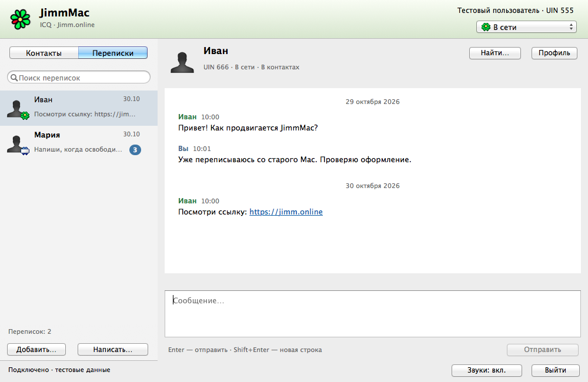
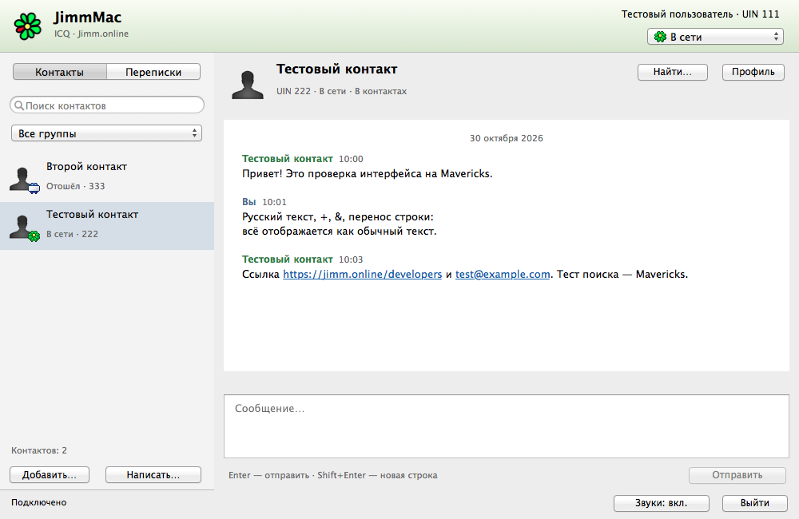
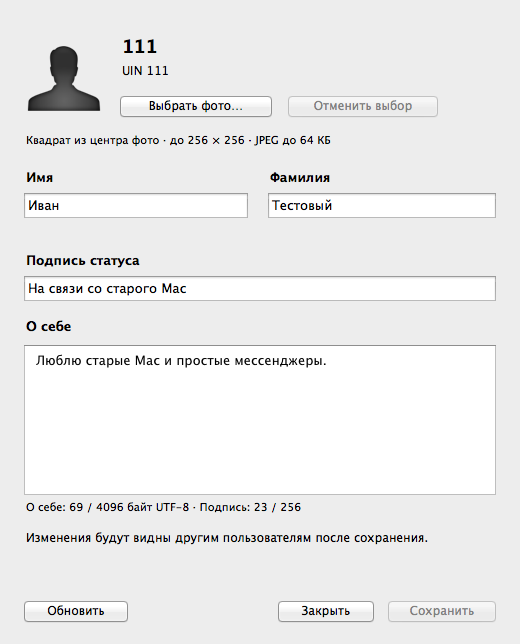
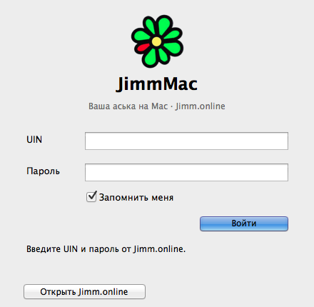
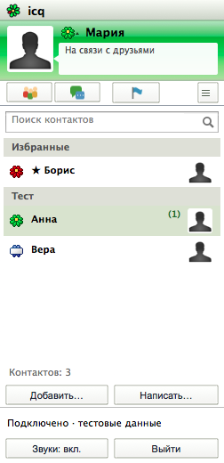
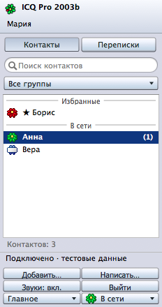
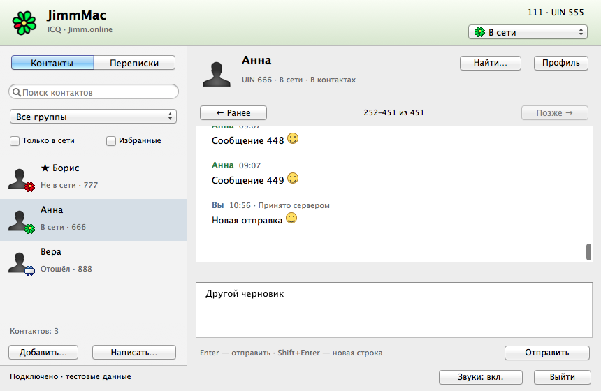

<div align="center">
  
  <h1>JimmMac</h1>
  <p><b>A familiar flower. An older Mac. A new conversation.</b></p>
  <p>
    
    
    
  </p>
  <p>
    <a href="https://github.com/MiChiRose/JimmMac/releases/latest"><b>Download JimmMac</b></a>
    · <a href="https://github.com/MiChiRose/JimmMac/issues">Report a problem</a>
    · <a href="../README.md">Read in Russian</a>
  </p>
</div>

## ICQ conversations, at home on a classic Mac

JimmMac is an independent client for [Jimm.online](https://jimm.online), a service
reviving ICQ-style messaging. It brings UIN sign-in, contacts and everyday text
conversations to Intel and Apple silicon Macs, with classic AppKit themes,
the green ICQ flower and familiar message sounds. The interface is available
in Russian, English, Ukrainian and Belarusian.

<p align="center">
  
</p>
<p align="center"><em>Native AppKit on Mavericks. Screenshot uses fictional conversations.</em></p>

## Download and install

| Download | What to choose |
| --- | --- |
| [Universal DMG 0.17.0](https://github.com/MiChiRose/JimmMac/releases/download/v0.17.0/JimmMac-0.17.0-macos10.13plus-universal.dmg) | Intel on macOS 10.13 or later, Apple silicon on macOS 11 or later. |
| [Universal ZIP 0.17.0](https://github.com/MiChiRose/JimmMac/releases/download/v0.17.0/JimmMac-0.17.0-macos10.13plus-universal.zip) | The same application in a ZIP archive. |
| [Legacy Intel DMG 0.16.0](https://github.com/MiChiRose/JimmMac/releases/download/v0.16.0/JimmMac-0.16.0-macos10.8-10.13-x86_64.dmg) | For older Intel Macs targeting OS X 10.8–macOS 10.13. |
| [Release notes and SHA-256 checksums](https://github.com/MiChiRose/JimmMac/releases/tag/v0.17.0) | Changes and checksums for 0.17.0. |

Open the DMG and drag JimmMac into Applications. Quit the running app before
replacing it. Version 0.17.0 is a public testing build with an ad hoc signature.
If macOS blocks the first launch, allow the app in Privacy & Security.
[Apple instructions](https://support.apple.com/en-us/102445).

Use a **Jimm.online UIN and password** to sign in. If you need an account, start at
[Jimm.online](https://jimm.online). Enable **«Запомнить меня»** to restore your login
after restarting the application.

## What you can do

- Keep **Contacts** and **Conversations** separate, find people by UIN, add contacts
  and organize them into groups.
- Send and receive text messages automatically, including offline messages, with
  unread counts, typing indicators and reconnection after a network interruption.
- Browse local history, search older messages, follow clickable links and reply
  with a quote.
- Leave a draft and return to it after restarting, with separate drafts for each
  conversation and account.
- View profiles and avatars, edit your own profile and photo, and change your
  online status with server confirmation.
- Adjust message fonts, sounds, notification previews and Enter-to-send behavior.
- Use native keyboard shortcuts, including Command shortcuts with a Russian
  keyboard layout. Open **«Справка → Сочетания клавиш…»** for the full reference.

<details>
<summary><b>A closer look: contacts, profile and sign-in</b></summary>

<p align="center">
  
  
  
</p>

</details>

## New in 0.17.0

- Universal build for Intel and Apple silicon.
- Pin chats and jump to the next unread conversation with **⌘U**.
- Jump to a conversation by name or UIN with **⌘K**.
- Reconnection status in the chat window and manual resend with confirmation.

## New in 0.16.0

- Added QIP and Jimm themes. Retro themes use original icons and classic smiley animations.
- The interface is available in Russian, English, Ukrainian and Belarusian.
- Block and unblock contacts, collapse contact groups and filter conversations by unread messages.
- Offline delivery and current-session history are merged by message ID to prevent duplicates.
- A progress window appears immediately when you check for updates manually.

## New in 0.15.0

- **Consistent utility windows.** Preferences, history search, profiles, groups,
  diagnostics and local data follow all three appearances while retaining native
  Mac window controls, text fields, focus and keyboard commands.
- **Diagnostics.** Help → Diagnostics shows connection state, transport and recent
  request codes. Copy Report excludes UINs, names, passwords, tokens, request URLs
  with parameters and message text.
- **Automatic status.** Preferences → Status offers 5, 10, 15, 30 or 60 minutes
  of Mac inactivity. Activity restores Online only after automatic Away; manual
  status choices take priority. This feature is off by default.
- **History navigation.** Search all conversations, the current one or a specific
  contact, filter by inclusive dates, or use Go to Date for the first message of
  a day. Right-click a message → Add Bookmark; File → Message Bookmarks opens saved
  messages. Bookmarks are included in portable `.jimmbackup` files.
- **Local data.** JimmMac → Local Data shows message counts, history and cache sizes,
  separate avatar cache cleanup, and history deletion by date range. Saving a backup
  before deletion is enabled by default; a failed backup prevents deletion.
  The original JSON migration file is retained separately.
- **Live preferences preview.** Preferences → Appearance shows sample messages with
  the chosen font and emoticons, regular/compact lists, and Restore Defaults.
  Resetting preferences keeps history, contacts, drafts and saved sign-in.

[0.15 verification on Mavericks](VERIFICATION-0.15.md): 1269 automated checks
and 583 RU/EN strings.

## New in 0.14

All 0.14 features are included in 0.16.0. The historical
source remains available under the `v0.14.2` tag.

- **Three appearances.** View → Appearance: Current, Nostalgia · ICQ for Mac 2011,
  and Nostalgia · ICQ Pro 2003b. Historical modes use a separate compact contact
  window. Double-click or press Enter to open a conversation. Switching preserves
  your draft; window controls and keyboard commands remain native to the Mac.
- **Offline history.** Use “Offline History…” on the sign-in screen or File →
  Open Offline History. Read, search, export and write drafts without connecting.
  Click Connect to send. Cached contact names remain available; presence is shown
  as offline rather than presenting an old online status as current.
- **Move to another Mac.** File → Create Backup saves a single `.jimmbackup` file
  with history, drafts, cached contacts and preferences. Restore Backup is available
  before sign-in. History merges without duplicates; differing drafts are retained
  together. Restoration opens offline mode and does not change the server contact
  list. Backups contain conversations, but no password or Keychain token; sign in
  again on the other Mac.
- **Muted conversations.** Right-click a contact → Mute Notifications. Incoming
  messages and unread counts are kept; banners, sounds and Dock attention for that
  conversation are suppressed. Use the same menu to unmute.
- **Russian and English.** View → Interface Language. Restart normally from Finder
  to apply the language to menus, windows, app messages and tooltips.

### Reference-based appearance in 0.14.2

Button and tab shapes, thin edges, corner radii and highlight direction follow
the selected references. The Mac 2011 header and Pro button gradients use sRGB
samples from those images. Pro has separate UIN and nickname fields, a dense
roster and a compact send bar. Mac 2011 uses a status speech bubble, icon
navigation, right-hand avatars, conversation tabs with status icons, and message
blocks with right-aligned timestamps. Group filtering is in the navigation menu.

[Sources and rendering measurements](HISTORICAL-REFERENCE.md).

<table><tr>
<td></td>
<td></td>
</tr></table>

Version 0.14.2 passed 835 automated checks and coverage checks for 514 RU/EN strings on **OS X 10.9.5**. Actual runs on 10.8 and 10.13 remain pending:
those systems are currently unavailable. One build retains the 10.8 deployment target.

## New in 0.13.0

The 0.13.0 features are included in 0.16.0.

- **Persistent unread messages.** Counts survive restarting. Opening a conversation
  reveals its first unread message; “К последним ↓” returns to the end and marks
  the conversation read when it is visible.
- **Larger histories.** SQLite stores individual messages, with at most 200 rendered
  at once. “Ранее” and “Позже” navigate pages. Search covers the full history and
  opens matches outside the current page. Legacy JSON migrates automatically and
  the original file remains as a backup.
- **Sending states.** Messages show Sending, Accepted by server, Failed or
  Confirmation not received. An uncertain message may have arrived. Right-click
  and choose “Повторить отправку…” to retry manually after confirmation, keeping
  the current draft. Server acceptance does not imply recipient delivery or reading.
- **Update checks.** “JimmMac → Проверить обновления…” checks GitHub's public API.
  Automatic checks run at launch and every six hours by default. A new version's
  dialog appears once when the main window is ready, without interrupting sign-in
  or other dialogs. Automatic checks can be disabled in the JimmMac menu.
  Installation remains manual; no account credentials are sent.
- **Favorites, filters and smileys.** Right-click a contact to add it to favorites.
  Starred contacts sort first. Online-only and favorites-only filters apply to the
  current list and are saved per account. Classic `:)`, `:(` and `;)` faces can be
  disabled in Conversation settings or the View menu. Sending, copying and export
  preserve the original text.
- **Conversation export.** Choose a peer, then File → Export conversation in TXT or
  HTML. The export includes the full conversation, authors, dates and unconfirmed
  sending states. HTML works offline and escapes message content.

<p align="center">
  
</p>

## New in 0.12.0

This release improves keyboard navigation, Escape and Enter behavior, undo/redo
isolation and clipboard shortcuts. Incoming messages preserve selected history
text so you can continue copying it. Account identity and connection status now
have separate places in the window.

The classic green-and-silver appearance includes new About and keyboard-help
windows. A decorated DMG provides drag-to-Applications installation. The network
layer now selects an OS X 10.8 fallback at runtime, keeping one application for
the full target range.

[Read the 0.12.0 release notes](https://github.com/MiChiRose/JimmMac/releases/tag/v0.12.0).

## Compatibility and testing

| Build | Verification |
| --- | --- |
| 0.17.0 for Apple silicon | Launch and focused UI checks on **macOS 27.2**. Requires macOS 11 or later. |
| 0.17.0 for Intel | Intel code launched under Rosetta on macOS 27.2. Requires macOS 10.13 or later. |
| 0.16.0 for older Intel Macs | Installation, saved login, and sending and receiving messages verified on **OS X 10.9.5**. |

Testing on physical Intel Macs with 10.13 or later is still pending.
See [VALIDATION.md](../VALIDATION.md) for coverage and limitations.

If you test it, please [open an issue](https://github.com/MiChiRose/JimmMac/issues)
with your OS version, JimmMac version, what you did and what happened. Installation,
sign-in, automatic incoming messages and restarting with a saved login are useful
first checks. Remove private conversation details from screenshots, and never
include passwords or session tokens.

## Your data

JimmMac does not save your password. Optional saved sign-in uses an expiring token
in the system Keychain. **Cmd+Q** keeps that login; **«Выйти из аккаунта»** removes it.

Message history and drafts are stored locally under
`~/Library/Application Support/JimmMac/`, separately for each account. The SQLite history and JSON drafts
are **not encrypted**. Search runs against local history. Notification
previews can be adjusted in Settings.

[Detailed behavior and storage notes, in Russian](GUIDE.ru.md#данные-и-сетевое-поведение).

## Build and explore

On a current Mac with Xcode Command Line Tools, build the Universal app and run
the native tests.

```sh
bash scripts/build.sh modern
JIMMMAC_NATIVE_TESTS=1 bash scripts/test.sh
```

Open `build/JimmMac.app` from Finder. To build for OS X 10.8, use
`bash scripts/build.sh legacy` with Xcode 5.1.1 or 6.2.

[Build, packaging and architecture guide](GUIDE.ru.md)
· [Verification record](../VALIDATION.md)
· [Jimm.online API documentation](https://jimm.online/developers)

## More life for older Macs

If you also use Telegram, take a look at
[Telegraphica for Mac](https://github.com/MiChiRose/telegraphica), our separate
client for older Intel Macs. The same link is available inside JimmMac under
**«Справка → Telegraphica для Mac…»** and in **«О JimmMac»**.

JimmMac is developed by **Yura Menschikov**. Thanks to the author of Jimm.online
for the service and API that make these conversations possible.

<sub>ICQ branding, graphics and sounds belong to their respective owners.
See <a href="../Resources/ASSET-SOURCES.md">asset sources and attribution</a>.</sub>
